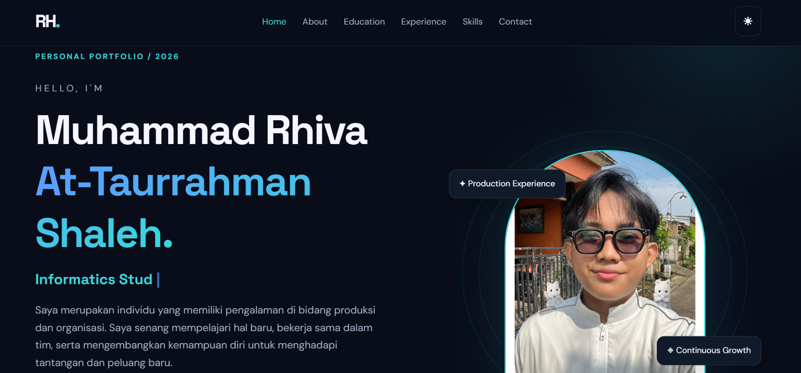
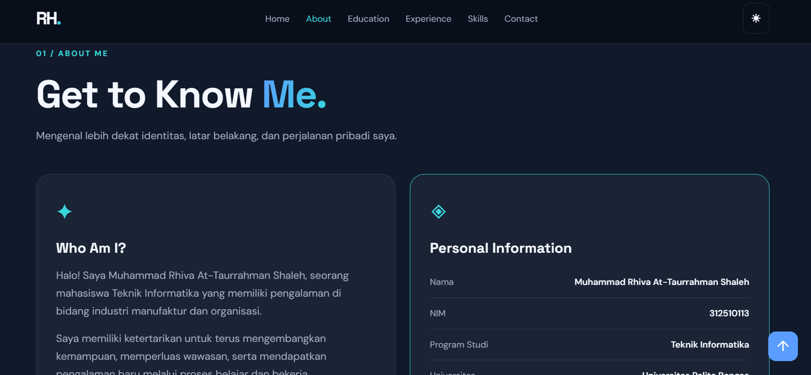
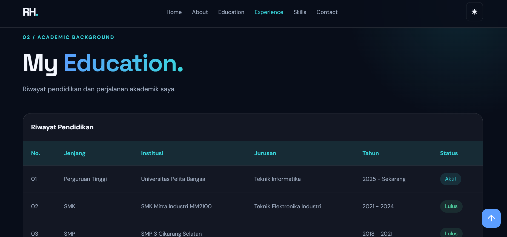
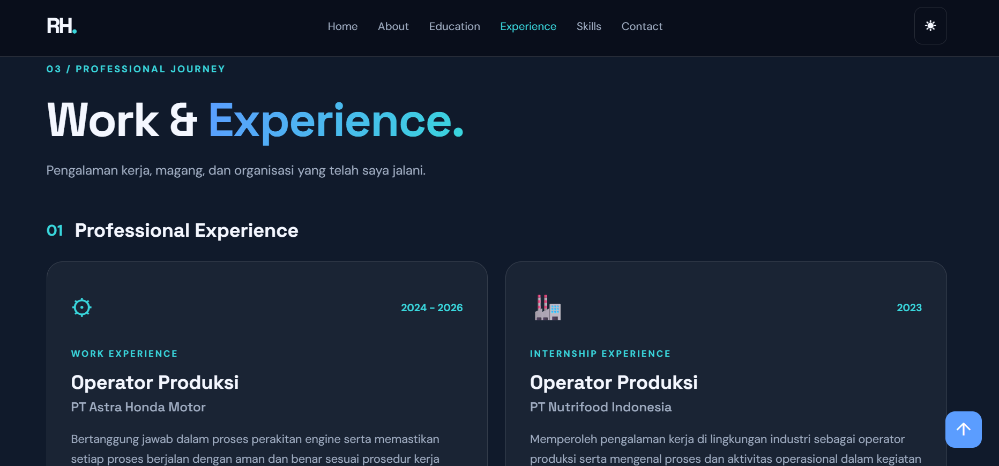
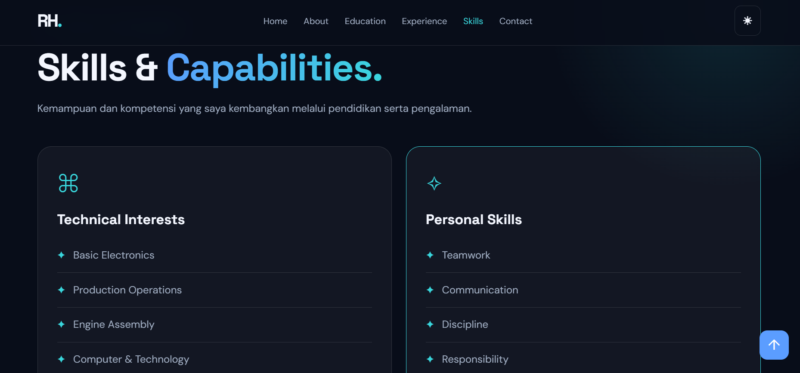
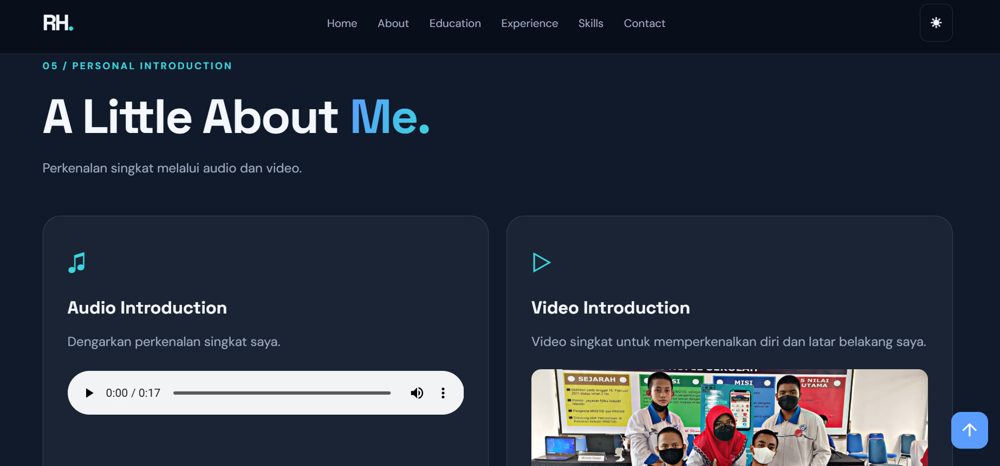
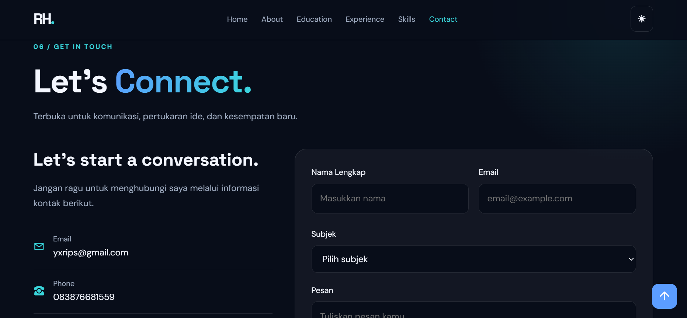

# PERSONAL PORTFOLIO WEBSITE

## 1. Identitas Mahasiswa

- **Nama:** Muhammad Rhiva At-Taurrahman Shaleh
- **NIM:** 312510113
- **Program Studi:** Teknik Informatika
- **Universitas:** Universitas Pelita Bangsa
- **Mata Kuliah:** Pemrograman Web
- **Dosen Pengampu:** Sufajar Butsianto, S.Kom., M.Kom.
- **Tahun:** 2026

## 2. Deskripsi Project

Personal Portfolio Website merupakan website profil pribadi yang dibuat untuk memenuhi Ujian Tengah Semester (UTS) mata kuliah Pemrograman Web.

Website ini menampilkan informasi mengenai profil pribadi, riwayat pendidikan, pengalaman kerja, pengalaman organisasi, keahlian, serta media perkenalan berupa audio dan video.

Website dirancang dengan tampilan modern, interaktif, dan responsif agar dapat diakses melalui berbagai ukuran layar.

## 3. Teknologi yang Digunakan

- **HTML5:** Membuat struktur dan konten website.
- **CSS3:** Mengatur desain, warna, tata letak, dan responsivitas.
- **JavaScript:** Menambahkan fitur interaktif pada website.

## 4. Fitur Website

1. Header, navigasi, dan hero section.
2. Profil dan biografi pribadi.
3. Tabel riwayat pendidikan.
4. Tabel pengalaman kerja.
5. Riwayat pengalaman organisasi.
6. Daftar keahlian menggunakan list.
7. Multimedia berupa audio dan video perkenalan.
8. Form kontak dengan validasi.
9. Dark mode dan light mode.
10. Animasi dan efek scrolling.

## 5. Proses Pembuatan Website

1. Menyiapkan folder dan struktur file project.
2. Membuat struktur halaman menggunakan HTML5.
3. Mendesain tampilan website menggunakan CSS3.
4. Menambahkan interaktivitas menggunakan JavaScript.
5. Memasukkan foto profil dan dokumentasi.
6. Menambahkan audio dan video perkenalan.
7. Menguji website menggunakan Visual Studio Code dan Live Server.
8. Memastikan seluruh fitur berjalan dengan baik.

## 6. Screenshot Hasil Website

### 1. Tampilan Home


### 2. Tampilan About


### 3. Tampilan Education


### 4. Tampilan Experience


### 5. Tampilan Skills


### 6. Personal Introduction


### 7. Tampilan Contact


## 7. Struktur Folder Project

```text
UTS/
├── index.html
├── style.css
├── script.js
├── images/
│   ├── profil.jpg
│   └── dokumentasi.jpg
├── media/
│   ├── perkenalan.mp3
│   └── perkenalan.mp4
└── README.md
```

## 8. Cara Menjalankan Website

1. Download atau clone repository.
2. Buka folder project menggunakan Visual Studio Code.
3. Pastikan seluruh file pendukung tersedia.
4. Buka file index.html.
5. Jalankan menggunakan Live Server.
6. Website akan terbuka melalui browser.

## 9. Penutup

Pembuatan Personal Portfolio Website ini menjadi sarana untuk menerapkan pengetahuan HTML5, CSS3, dan JavaScript dalam membangun website yang interaktif dan responsif.

---

**Muhammad Rhiva At-Taurrahman Shaleh**  
Universitas Pelita Bangsa  
2026
